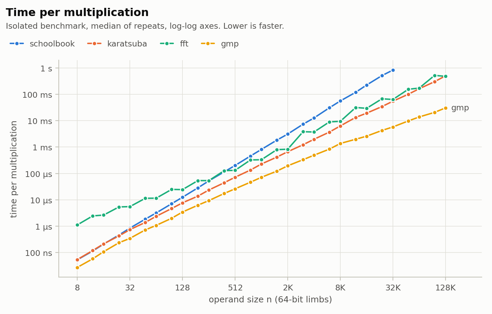
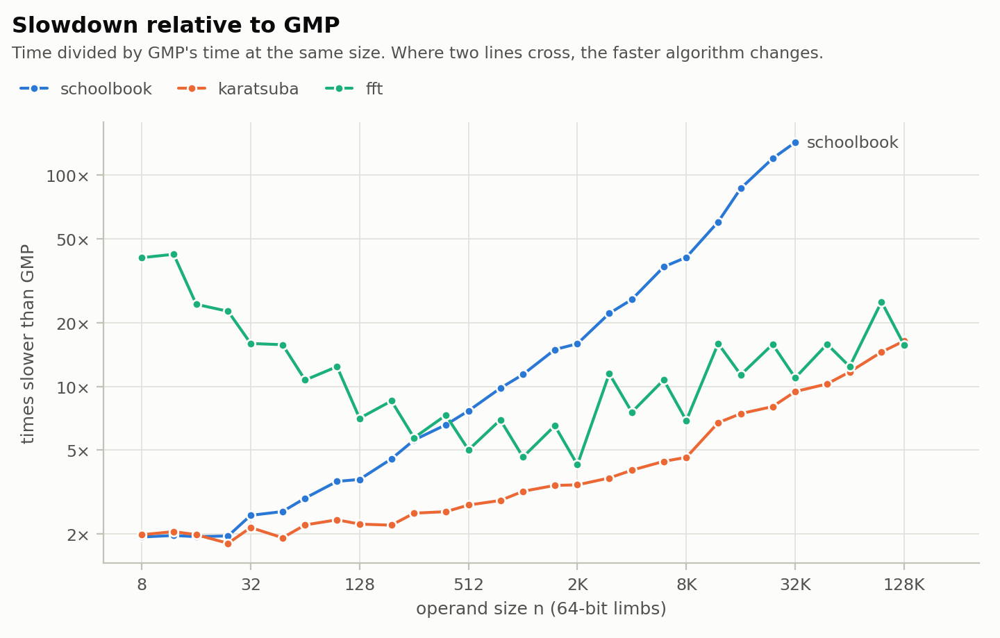
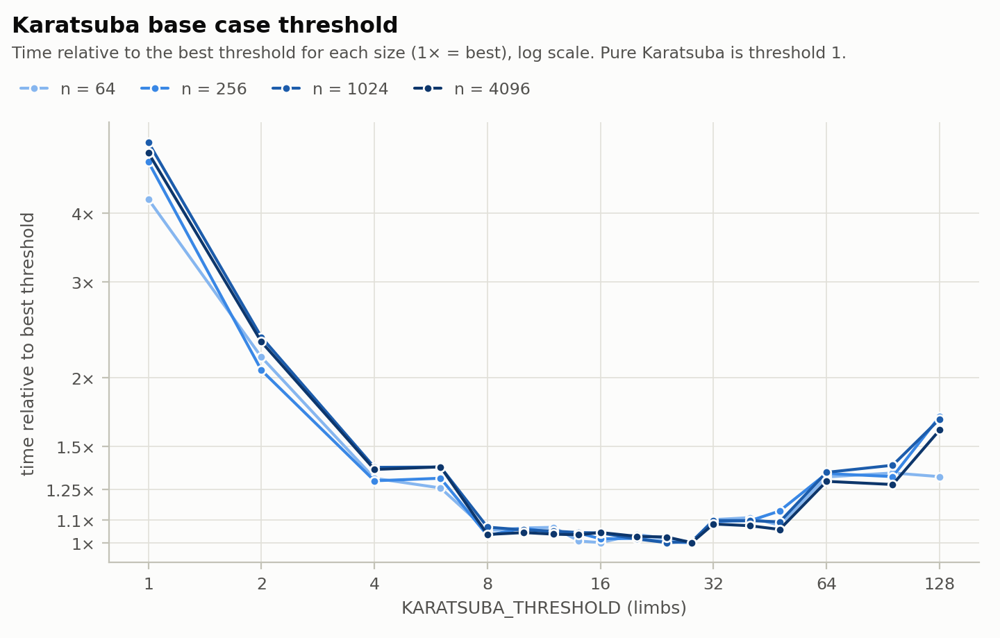
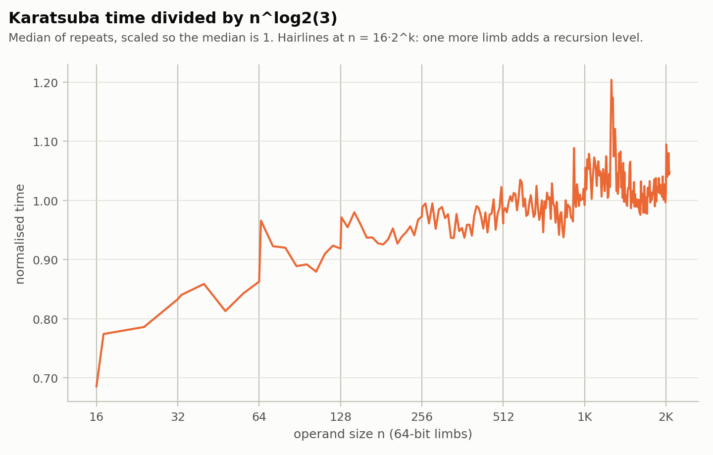

# Benchmark tables

Generated by `Code/AnalyseResults.py` from `Results/Raw/`. Do not edit by hand; rerun the script.
All times are medians over repeats, in microseconds per operation.

## Environment

- `date`: 2026-10-28T05:53:27Z
- `os`: Ubuntu 22.04.5 LTS
- `kernel`: Linux 6.18.54.1-microsoft-standard-WSL2
- `cpu`: 13th Gen Intel(R) Core(TM) i9-13900H
- `logical_cpus`: 20
- `compiler`: cc (Ubuntu 11.4.0-1ubuntu1~22.04.3) 11.4.0
- `gmp`: 6.2.1
- `cflags`: -O2 -std=gnu99 -Wall -Wextra
- `pinned_cpu`: 2
- `reps`: 5
- `sawtooth_reps`: 3
- `karatsuba_threshold`: 16
- `warmup`: 3
- `e2e_steps`: 20
- `e2e_iterations`: 5

## 1. Isolated multiplication time (µs)

| n (limbs) | bits | schoolbook | karatsuba | fft | gmp |
|---:|---:|---:|---:|---:|---:|
| 8 | 512 | 0.054 | 0.055 | 1.12 | 0.028 |
| 12 | 768 | 0.115 | 0.120 | 2.47 | 0.058 |
| 16 | 1,024 | 0.211 | 0.216 | 2.66 | 0.109 |
| 24 | 1,536 | 0.467 | 0.431 | 5.40 | 0.238 |
| 32 | 2,048 | 0.853 | 0.747 | 5.55 | 0.347 |
| 48 | 3,072 | 1.86 | 1.40 | 11.5 | 0.728 |
| 64 | 4,096 | 3.20 | 2.39 | 11.6 | 1.08 |
| 96 | 6,144 | 7.13 | 4.69 | 24.9 | 2.01 |
| 128 | 8,192 | 12.6 | 7.73 | 24.5 | 3.46 |
| 192 | 12,288 | 28.6 | 13.9 | 53.7 | 6.29 |
| 256 | 16,384 | 52.3 | 23.6 | 53.6 | 9.38 |
| 384 | 24,576 | 115 | 44.6 | 128 | 17.5 |
| 512 | 32,768 | 202 | 72.2 | 132 | 26.3 |
| 768 | 49,152 | 460 | 135 | 326 | 46.8 |
| 1024 | 65,536 | 816 | 229 | 332 | 71.6 |
| 1536 | 98,304 | 1,831 | 417 | 799 | 123 |
| 2048 | 131,072 | 3,111 | 668 | 832 | 195 |
| 3072 | 196,608 | 7,385 | 1,229 | 3,828 | 333 |
| 4096 | 262,144 | 12,705 | 1,978 | 3,722 | 492 |
| 6144 | 393,216 | 30,833 | 3,704 | 9,002 | 838 |
| 8192 | 524,288 | 56,013 | 6,333 | 9,458 | 1,371 |
| 12288 | 786,432 | 119,142 | 13,350 | 31,623 | 1,981 |
| 16384 | 1,048,576 | 224,621 | 19,293 | 29,451 | 2,593 |
| 24576 | 1,572,864 | 512,673 | 34,332 | 67,649 | 4,275 |
| 32768 | 2,097,152 | 828,365 | 54,826 | 63,666 | 5,795 |
| 49152 | 3,145,728 | – | 100,462 | 154,928 | 9,771 |
| 65536 | 4,194,304 | – | 162,527 | 172,268 | 13,869 |
| 98304 | 6,291,456 | – | 300,861 | 520,090 | 20,671 |
| 131072 | 8,388,608 | – | 501,473 | 480,531 | 30,552 |

Run-to-run spread, (max − min) / median over repeats: median 11.8% across all cells; worst five:

- fft at n = 6144: 129.7%
- schoolbook at n = 4096: 68.3%
- fft at n = 24576: 61.6%
- gmp at n = 6144: 61.2%
- gmp at n = 12288: 54.0%

## 2. Ratios at selected sizes

| n (limbs) | schoolbook / karatsuba | fft / karatsuba | karatsuba / gmp | schoolbook / fft |
|---:|---:|---:|---:|---:|
| 8 | 0.98 | 20.47 | 1.99 | 0.05 |
| 12 | 0.96 | 20.53 | 2.06 | 0.05 |
| 16 | 0.98 | 12.31 | 1.99 | 0.08 |
| 24 | 1.08 | 12.53 | 1.81 | 0.09 |
| 32 | 1.14 | 7.43 | 2.15 | 0.15 |
| 48 | 1.33 | 8.20 | 1.92 | 0.16 |
| 64 | 1.34 | 4.85 | 2.21 | 0.28 |
| 96 | 1.52 | 5.31 | 2.34 | 0.29 |
| 128 | 1.63 | 3.17 | 2.23 | 0.51 |
| 192 | 2.06 | 3.87 | 2.21 | 0.53 |
| 256 | 2.22 | 2.27 | 2.51 | 0.98 |
| 384 | 2.58 | 2.86 | 2.56 | 0.90 |
| 512 | 2.79 | 1.82 | 2.75 | 1.53 |
| 768 | 3.40 | 2.41 | 2.89 | 1.41 |
| 1024 | 3.57 | 1.45 | 3.19 | 2.46 |
| 1536 | 4.39 | 1.92 | 3.40 | 2.29 |
| 2048 | 4.66 | 1.24 | 3.42 | 3.74 |
| 3072 | 6.01 | 3.12 | 3.69 | 1.93 |
| 4096 | 6.42 | 1.88 | 4.02 | 3.41 |
| 6144 | 8.32 | 2.43 | 4.42 | 3.43 |
| 8192 | 8.84 | 1.49 | 4.62 | 5.92 |
| 12288 | 8.92 | 2.37 | 6.74 | 3.77 |
| 16384 | 11.64 | 1.53 | 7.44 | 7.63 |
| 24576 | 14.93 | 1.97 | 8.03 | 7.58 |
| 32768 | 15.11 | 1.16 | 9.46 | 13.01 |
| 49152 | – | 1.54 | 10.28 | – |
| 65536 | – | 1.06 | 11.72 | – |
| 98304 | – | 1.73 | 14.55 | – |
| 131072 | – | 0.96 | 16.41 | – |

## 3. Crossovers

Interpolated in log space between the two measured sizes either side of each sign change.

| pair | source | bracket (limbs) | interpolated n | faster above the crossing |
|---|---|---|---:|---|
| schoolbook vs karatsuba | fine sweep (step 2) | 16–18 | 17 | karatsuba |
| schoolbook vs karatsuba | main grid | 16–24 | 17 | karatsuba |
| schoolbook vs fft | main grid | 384–512 | 406 | fft |
| karatsuba vs fft | main grid | 98304–131072 | 128374 | fft |
| fft vs gmp | main grid | none in 8–131072 | – | gmp throughout |
| karatsuba vs gmp | main grid | none in 8–131072 | – | gmp throughout |

## 4. Empirical growth exponents

Slope of log t against log n. Theory: schoolbook 2, Karatsuba log2(3) ≈ 1.585, FFT n log n (slope just above 1).

| algorithm | fit n ≥ 1024 | 8→16 | 16→32 | 32→64 | 64→128 | 128→256 | 256→512 | 512→1024 | 1024→2048 | 2048→4096 | 4096→8192 | 8192→16384 | 16384→32768 | 32768→65536 | 65536→131072 |
|---|---:|---:|---:|---:|---:|---:|---:|---:|---:|---:|---:|---:|---:|---:|---:|
| schoolbook | 2.021 | 1.98 | 2.01 | 1.91 | 1.97 | 2.06 | 1.94 | 2.02 | 1.93 | 2.03 | 2.14 | 2.00 | 1.88 | – | – |
| karatsuba | 1.586 | 1.97 | 1.79 | 1.68 | 1.69 | 1.61 | 1.61 | 1.66 | 1.55 | 1.57 | 1.68 | 1.61 | 1.51 | 1.57 | 1.63 |
| fft | 1.497 | 1.24 | 1.06 | 1.06 | 1.08 | 1.13 | 1.30 | 1.33 | 1.33 | 2.16 | 1.35 | 1.64 | 1.11 | 1.44 | 1.48 |
| gmp | 1.229 | 1.97 | 1.68 | 1.64 | 1.68 | 1.44 | 1.49 | 1.45 | 1.45 | 1.33 | 1.48 | 0.92 | 1.16 | 1.26 | 1.14 |

## 5. Karatsuba threshold sweep

Time relative to the best threshold for that size (1.00 = best); raw medians in µs in the second table.

| threshold | n = 64 | n = 256 | n = 1000 | n = 1024 | n = 3000 | n = 4096 | geometric mean |
|---:|---:|---:|---:|---:|---:|---:|---:|
| 1 | 4.24 | 4.97 | 5.52 | 5.39 | 5.99 | 5.16 | 5.183 |
| 2 | 2.18 | 2.07 | 2.37 | 2.38 | 2.84 | 2.33 | 2.350 |
| 4 | 1.31 | 1.30 | 1.43 | 1.37 | 1.75 | 1.36 | 1.414 |
| 6 | 1.26 | 1.31 | 1.37 | 1.37 | 1.23 | 1.38 | 1.319 |
| 8 | 1.05 | 1.03 | 1.11 | 1.07 | 1.14 | 1.03 | 1.072 |
| 10 | 1.06 | 1.06 | 1.10 | 1.05 | 1.17 | 1.04 | 1.081 |
| 12 | 1.07 | 1.04 | 1.09 | 1.05 | 1.01 | 1.04 | 1.049 |
| 14 | 1.01 | 1.04 | 1.06 | 1.04 | 1.00 | 1.03 | 1.030 |
| 16 | 1.00 | 1.02 | 1.02 | 1.04 | 1.01 | 1.04 | 1.022 |
| 20 | 1.04 | 1.02 | 1.00 | 1.02 | 1.01 | 1.03 | 1.017 |
| 24 | 1.02 | 1.00 | 1.04 | 1.00 | 1.04 | 1.02 | 1.021 |
| 28 | 1.00 | 1.00 | 1.02 | 1.00 | 1.04 | 1.00 | 1.012 |
| 32 | 1.10 | 1.09 | 1.07 | 1.10 | 1.03 | 1.08 | 1.078 |
| 40 | 1.11 | 1.10 | 1.10 | 1.10 | 1.02 | 1.07 | 1.083 |
| 48 | 1.08 | 1.14 | 1.09 | 1.09 | 1.17 | 1.06 | 1.104 |
| 64 | 1.32 | 1.34 | 1.30 | 1.34 | 1.18 | 1.29 | 1.295 |
| 96 | 1.34 | 1.32 | 1.30 | 1.39 | 1.43 | 1.28 | 1.341 |
| 128 | 1.32 | 1.70 | 1.62 | 1.68 | 1.48 | 1.61 | 1.563 |

| threshold | n = 64 | n = 256 | n = 1000 | n = 1024 | n = 3000 | n = 4096 |
|---:|---:|---:|---:|---:|---:|---:|
| 1 | 9.77 | 110 | 1,104 | 1,107 | 7,003 | 9,831 |
| 2 | 5.03 | 45.7 | 475 | 488 | 3,324 | 4,435 |
| 4 | 3.02 | 28.7 | 287 | 282 | 2,051 | 2,592 |
| 6 | 2.90 | 29.0 | 274 | 282 | 1,440 | 2,620 |
| 8 | 2.42 | 22.8 | 223 | 219 | 1,333 | 1,971 |
| 10 | 2.45 | 23.5 | 219 | 217 | 1,368 | 1,987 |
| 12 | 2.46 | 23.0 | 219 | 216 | 1,180 | 1,974 |
| 14 | 2.32 | 23.0 | 212 | 214 | 1,170 | 1,969 |
| 16 | 2.30 | 22.5 | 205 | 214 | 1,179 | 1,988 |
| 20 | 2.38 | 22.5 | 200 | 208 | 1,176 | 1,956 |
| 24 | 2.34 | 22.2 | 209 | 205 | 1,214 | 1,951 |
| 28 | 2.31 | 22.1 | 204 | 206 | 1,221 | 1,905 |
| 32 | 2.54 | 24.2 | 214 | 225 | 1,200 | 2,060 |
| 40 | 2.56 | 24.2 | 220 | 225 | 1,194 | 2,045 |
| 48 | 2.48 | 25.3 | 218 | 224 | 1,372 | 2,014 |
| 64 | 3.04 | 29.6 | 261 | 276 | 1,379 | 2,466 |
| 96 | 3.09 | 29.2 | 260 | 284 | 1,674 | 2,433 |
| 128 | 3.04 | 37.6 | 324 | 345 | 1,736 | 3,060 |

## 6. Karatsuba either side of each recursion level change (threshold 16)

At n = 16·2^k the leaves are exactly 16 limbs; one more limb adds a level and roughly halves the leaves.

| n | time (µs) | n + 1 | time (µs) | ratio (n + 1) / n | expected from n^1.585 |
|---:|---:|---:|---:|---:|---:|
| 32 | 0.719 | 33 | 0.761 | 1.059 | 1.050 |
| 64 | 2.23 | 65 | 2.56 | 1.147 | 1.025 |
| 128 | 7.14 | 129 | 7.64 | 1.071 | 1.012 |
| 256 | 22.7 | 257 | 23.2 | 1.022 | 1.006 |
| 512 | 67.2 | 513 | 68.8 | 1.024 | 1.003 |
| 1024 | 209 | 1025 | 208 | 0.998 | 1.002 |
| 2048 | 636 | 2049 | 645 | 1.014 | 1.001 |

Mean of time / n^1.585 (ns) over each band between level changes, per repeat. Consistent repeats mean a band level is real; the band to band drift is the lower order (linear) terms and memory effects.

| band (limbs) | repeat 1 | repeat 2 | repeat 3 |
|---|---:|---:|---:|
| 17–32 | 2.781 | 2.773 | 2.841 |
| 33–64 | 2.987 | 2.986 | 3.007 |
| 65–128 | 3.378 | 3.198 | 3.244 |
| 129–256 | 3.416 | 3.440 | 3.389 |
| 257–512 | 3.474 | 3.449 | 3.478 |
| 513–1024 | 3.529 | 3.605 | 3.531 |
| 1025–2048 | 3.583 | 3.781 | 3.679 |
| 2049–2112 | 3.742 | 3.848 | 3.729 |

Fine structure check for n ≥ 256: correlation of the normalised curve between pairs of repeats = 0.03, 0.08, 0.35; median run-to-run spread 5.8%. Correlations near zero mean size to size wiggles at that scale are noise, not structure.

## 7. End to end modular squaring chain (20 squarings per chain)

Per squaring = chain time / steps. Overhead = per squaring time / isolated multiplication time − 1, i.e. the cost of the fold, increment and copy plus any cache effects.

| algorithm | n (limbs) | chain (µs) | per squaring (µs) | isolated mul (µs) | overhead |
|---|---:|---:|---:|---:|---:|
| schoolbook | 16 | 4.59 | 0.230 | 0.211 | +8.6% |
| schoolbook | 64 | 58.0 | 2.90 | 3.20 | -9.5% |
| schoolbook | 256 | 1,064 | 53.2 | 52.3 | +1.6% |
| schoolbook | 1024 | 15,589 | 779 | 816 | -4.5% |
| schoolbook | 4096 | 256,742 | 12,837 | 12,705 | +1.0% |
| karatsuba | 16 | 4.62 | 0.231 | 0.216 | +7.0% |
| karatsuba | 64 | 42.1 | 2.11 | 2.39 | -12.0% |
| karatsuba | 256 | 454 | 22.7 | 23.6 | -3.8% |
| karatsuba | 1024 | 4,361 | 218 | 229 | -4.6% |
| karatsuba | 4096 | 40,820 | 2,041 | 1,978 | +3.2% |
| karatsuba | 16384 | 352,070 | 17,604 | 19,293 | -8.8% |
| fft | 16 | 40.4 | 2.02 | 2.66 | -24.0% |
| fft | 64 | 184 | 9.18 | 11.6 | -20.9% |
| fft | 256 | 1,179 | 58.9 | 53.6 | +9.9% |
| fft | 1024 | 7,154 | 358 | 332 | +7.7% |
| fft | 4096 | 73,717 | 3,686 | 3,722 | -1.0% |
| fft | 16384 | 507,470 | 25,373 | 29,451 | -13.8% |
| gmp | 16 | 2.49 | 0.125 | 0.109 | +14.7% |
| gmp | 64 | 21.5 | 1.07 | 1.08 | -0.7% |
| gmp | 256 | 178 | 8.89 | 9.38 | -5.3% |
| gmp | 1024 | 1,488 | 74.4 | 71.6 | +3.8% |
| gmp | 4096 | 9,487 | 474 | 492 | -3.7% |
| gmp | 16384 | 51,802 | 2,590 | 2,593 | -0.1% |

## Figures

